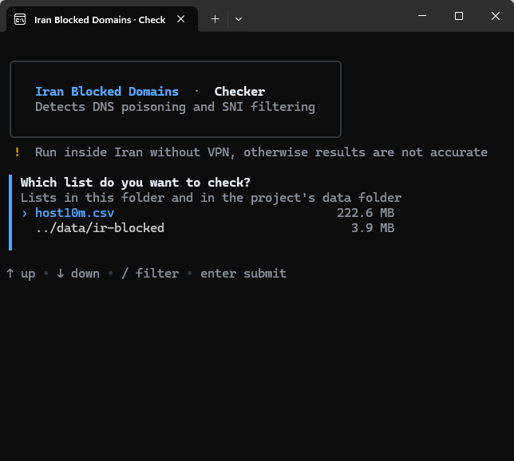
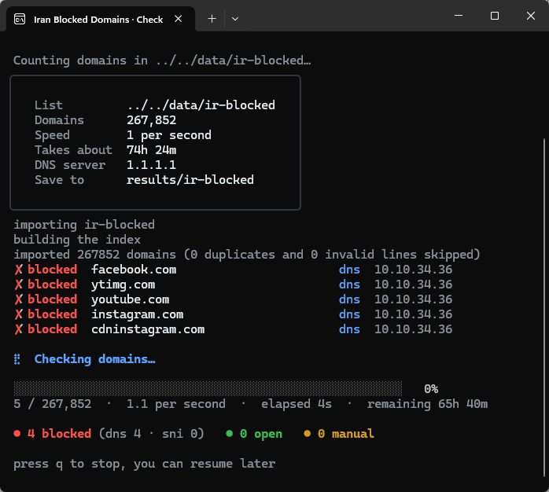

<div dir="ltr">

# List of Blocked Domains in Iran

Many domains are blocked by the government in Iran.
The purpose of this project is to identify these domains, so that only their traffic is routed through a VPN or proxy.
This makes the VPN server harder to detect and block.

Number of detected blocked domains: **267,852**

## Download

The latest release, built from [data/ir-blocked](data/ir-blocked) by GitHub Actions:

- [ir-blocked.dat](https://github.com/armanlife/iran-blocked-domains/releases/latest/download/ir-blocked.dat) for V2Ray and Xray: put it next to `geosite.dat` and use `ext:ir-blocked.dat:ir-blocked` in the routing rules
- [ir-blocked.srs](https://github.com/armanlife/iran-blocked-domains/releases/latest/download/ir-blocked.srs) for sing-box and the clients built on it, such as Hiddify and NekoBox
- [ir-blocked-clash.txt](https://github.com/armanlife/iran-blocked-domains/releases/latest/download/ir-blocked-clash.txt) for Clash Meta and Mihomo, as a rule provider with `behavior: domain` and `format: text`
- [ir-blocked-surge.txt](https://github.com/armanlife/iran-blocked-domains/releases/latest/download/ir-blocked-surge.txt) for Surge, Shadowrocket and Stash, as a rule set
- [ir-blocked.txt](https://github.com/armanlife/iran-blocked-domains/releases/latest/download/ir-blocked.txt): one domain per line, in rank order, so the first lines are the most important domains

Every format matches each domain and its subdomains. The list is large, so it may be slow on weak routers and phones.

## Checking domains

The code that finds the blocked domains is in [checker](checker/). With it you can check any domain or list of domains from inside Iran.

<p>
  
  
</p>

</div>
<br>
<div dir="rtl">

# لیست دامنه‌های فیلترشده در ایران

## هدف پروژه

هدف این پروژه شناسایی وب‌سایت‌های فیلترشده در ایران است.
با شناسایی این وب‌سایت‌ها می‌توانیم فقط ترافیک سایت‌های فیلترشده را از VPN عبور دهیم.
این کار شناسایی VPN را سخت‌تر می‌کند و در مصرف پهنای باند هم صرفه‌جویی می‌شود.

تعداد دامنه‌های فیلترشده‌ی شناسایی‌شده: **267,852**

## دانلود

آخرین نسخه که GitHub Actions از روی [data/ir-blocked](data/ir-blocked) می‌سازد:

- فایل [ir-blocked.dat](https://github.com/armanlife/iran-blocked-domains/releases/latest/download/ir-blocked.dat) برای V2Ray و Xray: کنار `geosite.dat` بگذارید و در قانون‌های مسیریابی `ext:ir-blocked.dat:ir-blocked` بنویسید
- فایل [ir-blocked.srs](https://github.com/armanlife/iran-blocked-domains/releases/latest/download/ir-blocked.srs) برای sing-box و برنامه‌هایی که روی آن ساخته شده‌اند، مثل Hiddify و NekoBox
- فایل [ir-blocked-clash.txt](https://github.com/armanlife/iran-blocked-domains/releases/latest/download/ir-blocked-clash.txt) برای Clash Meta و Mihomo، به‌صورت rule provider با `behavior: domain` و `format: text`
- فایل [ir-blocked-surge.txt](https://github.com/armanlife/iran-blocked-domains/releases/latest/download/ir-blocked-surge.txt) برای Surge، Shadowrocket و Stash، به‌صورت rule set
- فایل [ir-blocked.txt](https://github.com/armanlife/iran-blocked-domains/releases/latest/download/ir-blocked.txt) لیست ساده است: هر خط یک دامنه به ترتیب رتبه، یعنی خط‌های اول مهم‌ترین دامنه‌ها هستند

همه‌ی فرمت‌ها هر دامنه و زیردامنه‌هایش را شامل می‌شوند. لیست بزرگ است و ممکن است روی روترها و گوشی‌های ضعیف کند باشد.

## نحوه‌ی استفاده

- [تفکیک ترافیک سایت‌های فیلترشده در OpenWrt][link-openwrt]

## نحوه‌ی تشخیص فیلتر بودن دامنه

یکی از روش‌های تشخیص فیلتر بودن یک دامنه، استفاده از DNS است.

اولین قدم برای دسترسی به اینترنت DNS است. وقتی نام یک دامنه را وارد می‌کنید، این نام باید به IP تبدیل شود تا دستگاه شما بتواند با سرور آن ارتباط برقرار کند.
سیستم فیلترینگ ایران با دستکاری DNS، به جای IP اصلی یکی از این سه IP را برمی‌گرداند:

```INI
10.10.34.34
10.10.34.35
10.10.34.36
```

بعضی دامنه‌ها در DNS دستکاری نمی‌شوند، اما سیستم فیلترینگ اتصال آن‌ها را با بررسی نام دامنه (SNI) قطع می‌کند.

برای اطلاعات بیشتر درباره‌ی DNS به نوشته‌های [ویکی سانسور][link-wikicensorship] مراجعه کنید:

- [بررسی سانسور اینترنت در ارتباط DNS][link-wikicensorship-dns]

## بررسی دامنه‌ها

کد پیدا کردن دامنه‌های فیلترشده در پوشه‌ی [checker](checker/) است. با آن می‌توانید هر دامنه یا لیستی از دامنه‌ها را از داخل ایران بررسی کنید.
## مرجع

مرجع دامنه‌ها [رتبه‌بندی host.io](https://host.io/rankings) است.

</div>

[link-wikicensorship]: https://wikicensorship.github.io/fa/docs/measure-internet-censorship/
[link-wikicensorship-dns]: https://wikicensorship.github.io/fa/docs/measure-internet-censorship/DNS/
[link-openwrt]: docs/openwrt.md
